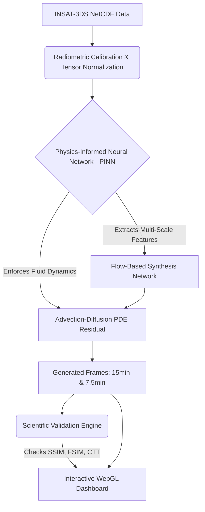
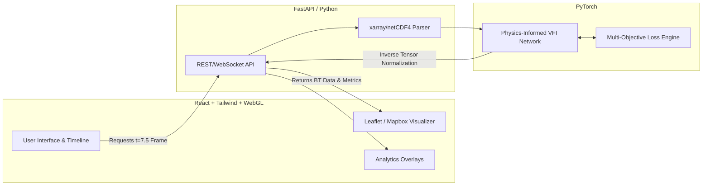

# Next-Generation AI/ML Techniques for Geostationary Satellite Imagery
## Presentation Content & Prompts (Updated with Deep Research)

---

### 1) Opportunity Explanation

**How different is it from any of the other existing ideas?**
Currently, ISRO uses tools like PySTEPS (Hydro-Estimator Nowcaster) which rely on classical Eulerian optical flow (Lucas-Kanade) based on "brightness constancy." This assumption fails because clouds are non-rigid and undergo complex thermodynamic phase changes (condensation/evaporation) as they move. Our AI solution departs from traditional pixel-warping. By utilizing a **Physics-Informed Temporal U-Net (PINN)**, our model doesn't just track pixels—it explicitly enforces advection-diffusion fluid dynamics. This means it learns the actual physical laws of the atmosphere, preventing the blurring and ghosting artifacts seen in legacy methods.

**How will it be able to solve the problem?**
Geostationary satellites like INSAT-3DS suffer from temporal scanning limitations, typically providing full-disk scans only every 30 minutes. This gap is too large to track fast-moving events like flash floods or rapid cyclogenesis. Our Deep Learning Video Frame Interpolation (VFI) network computationally bridges this gap. It synthesizes missing high-fidelity cloud textures, increasing temporal resolution from 30 minutes to 15 minutes, and recursively down to 7.5 minutes, without needing additional expensive satellite hardware.

**USP (Unique Selling Proposition) of the proposed solution**
A highly differentiated, physics-constrained AI architecture explicitly designed for scientific satellite data formats (NetCDF/HDF5) and Thermal Infrared (TIR-1) radiometric radiances. Unlike off-the-shelf AI video interpolators (which use standard RGB and MSE loss), our model uses a **Multi-Objective Loss Engine** (incorporating Perceptual Texture Loss and Physics-Informed PDE Proxies) to preserve critical Cloud Top Temperatures (CTT) and ensure Atmospheric Motion Vector (AMV) consistency.

---

### 2) List of Features Offered by the Solution

- **Physics-Informed Recursive Upscaling:** Generates meteorologically valid 15-min and 7.5-min interval frames from a 30-min baseline using advanced architectures (inspired by FILM/RIFE/PINNs).
- **Native Scientific Data Processing:** Natively handles `.nc` and `.h5` files, transforming raw digital counts into precise Brightness Temperatures (BT) without destructive 8-bit compression.
- **Event-Augmented Motion Tracking:** Anticipates non-linear cloud motion (like a cyclone accelerating) by utilizing temporal derivatives of previous frame sequences.
- **Scientific Validation Engine & Error Maps:** Real-time calculation of quantitative metrics (PSNR, SSIM, FSIM, MSE) combined with physical checks (Cloud Top Temperature distribution preservation).
- **Interactive WebGL Visualizer Dashboard:** A high-performance web dashboard featuring synchronized time-lapse comparisons and custom shaders for highlighting severe convection zones (temperatures below 210 K).

*(Tip: In your PPT, add a side-by-side visual comparing a blurred PySTEPS interpolation vs. our crisp PINN interpolation here)*

---

### 3) Process Flow Diagram

Here is a Mermaid diagram you can render or adapt into your presentation:

---

### 4) Wireframes / Mock Diagrams of the Proposed Solution (Prompts)

If you are using an AI image generator (like Midjourney, DALL-E 3, or Adobe Firefly) to create professional mockups for your PPT, use these prompts:

**Prompt for Main Web Dashboard Mockup:**
> "A sleek, professional dark-themed software dashboard for meteorological satellite tracking. The main interface displays a vibrant geographic heatmap of a cyclone, with deep reds and blacks highlighting extreme cold cloud tops. Surrounding the map are modern glassmorphism panels showing scientific graphs, validation metrics (SSIM, FSIM, PSNR), and a timeline slider. Neon cyan and deep blue accents, high resolution, futuristic yet scientifically accurate UI design."

**Prompt for Physics-Informed AI Feature Graphic:**
> "A split-screen scientific visualization graphic. The left side shows a low frame-rate, blurry thermal satellite image of a storm system (labeled 'Traditional Optical Flow'). The right side shows a highly detailed, smooth, and crisp thermal image of the same storm with sharp convective boundaries (labeled 'Physics-Informed AI'). Professional corporate typography, dark background with subtle mathematical grids, high contrast."

---

### 5) Architecture Diagram of the Proposed Solution

---

### 6) Technologies to be Used in the Solution

**Frontend Layer (Visualization):**
- **React.js & Vite:** For a highly responsive, fast web interface.
- **TailwindCSS & Lucide Icons:** Modern UI styling.
- **Leaflet.js / Mapbox GL JS:** For dynamic spatial rendering with custom WebGL shaders to map brightness temperatures.
- **Recharts:** For rendering comparative scientific metric charts.

**Backend & AI Layer (Processing & Generation):**
- **Python (FastAPI):** High-performance backend API serving data to the frontend.
- **PyTorch:** The core deep learning framework used to train the Physics-Informed Temporal U-Net.
- **xarray & netCDF4 / h5py:** Natively parsing and handling scientific floating-point satellite data structures.
- **OpenCV & NumPy:** For tensor normalization, Min-Max scaling, and radiometric calibration.

---

### 7) Estimated Implementation Cost

*This cost estimate is geared towards transitioning the hackathon prototype into a highly scalable, production-ready system.*

- **Data Acquisition:** $0 (Data sourced freely from ISRO MOSDAC / IMD / NOAA).
- **Development & Pre-Training:** $0 (Utilizing local hardware, Google Colab, and open-source frameworks like PyTorch).
- **Production Infrastructure (Monthly Estimate):**
  - **Cloud Compute (AWS EC2 / GCP Compute Engine):** 1x GPU Instance (e.g., NVIDIA T4 or A10G) for rapid recurrent inference. ~$300 - $600 / month.
  - **Storage (AWS S3 / GCP Cloud Storage):** For archiving raw `.nc` inputs and generated frame outputs. ~$50 / month.
  - **Web Hosting (Vercel / Netlify):** For frontend delivery and Edge functions. $0 to $20 / month.
- **Total Estimated Operating Cost:** ~$350 - $670 / month (Highly scalable depending on whether the system runs continuously or on-demand during severe weather events).
