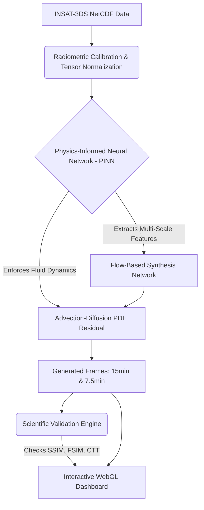

# Next-Generation AI/ML Techniques for Geostationary Satellite Imagery
## Presentation Content & Prompts (Updated)

---

### 1) The Solution (Our Approach)

**What are we building?**
We have built an end-to-end AI/ML optical flow pipeline designed to generate high-fidelity, synthetic intermediate satellite frames. This effectively upgrades the temporal resolution of existing satellite networks from 30 minutes to 15 minutes, or even 7.5 minutes, without requiring any new hardware in orbit.

**How different is it from any of the other existing ideas?**
Currently, ISRO uses tools like PySTEPS (Hydro-Estimator Nowcaster) which rely on classical Eulerian optical flow (Lucas-Kanade) based on "brightness constancy." This assumption fails because clouds are non-rigid and undergo complex thermodynamic phase changes (condensation/evaporation) as they move. Our AI solution departs from traditional pixel-warping. By utilizing a **Physics-Informed Temporal U-Net (PINN)**, our model doesn't just track pixels—it explicitly enforces advection-diffusion fluid dynamics. This means it learns the actual physical laws of the atmosphere, preventing the blurring and ghosting artifacts seen in legacy methods.

---

### 2) The Problem & Opportunity

Geostationary satellites like INSAT-3DS suffer from temporal scanning limitations, typically providing full-disk scans only every 30 minutes. This gap is too large to track fast-moving events like flash floods or rapid cyclogenesis. Our Deep Learning Video Frame Interpolation (VFI) network computationally bridges this gap. It synthesizes missing high-fidelity cloud textures, allowing us to track rapid intensification that would normally go undetected between real frames.

**USP (Unique Selling Proposition)**
A highly differentiated, physics-constrained AI architecture explicitly designed for scientific satellite data formats (NetCDF/HDF5) and Thermal Infrared (TIR-1) radiometric radiances. Unlike off-the-shelf AI video interpolators, our model uses a **Multi-Objective Loss Engine** to preserve critical Cloud Top Temperatures (CTT).

---

### 3) List of Features Offered by the Solution

- **Physics-Informed Recursive Upscaling:** Generates meteorologically valid 15-min and 7.5-min interval frames from a 30-min baseline.
- **Native Scientific Data Processing:** Natively handles `.nc` and `.h5` files, transforming raw digital counts into precise Brightness Temperatures.
- **Event-Augmented Motion Tracking:** Anticipates non-linear cloud motion (like a cyclone accelerating).
- **Scientific Validation Engine & Error Maps:** Real-time calculation of quantitative metrics (PSNR, SSIM, FSIM, MSE) with automatic qualitative assessment.
- **Interactive Research Dashboard (MOSDAC UI Clone):** 
  - **Slider Comparison Mode:** Draggable overlay comparing AI predictions directly against Ground Truth.
  - **MOSDAC Timeline Player:** Synchronized time-lapse sequence viewer mimicking official ISRO tools.
  - **Differential Heatmaps:** High-contrast Thermal Gradient analysis (Sobel edge detection).
  - **Native `.h5` & PNG Export:** Export raw interpolated tensors natively for downstream meteorological processing.

---

### 4) Process Flow Diagram

---

### 5) Technologies to be Used in the Solution

**Frontend Layer (Visualization):**
- **React.js & Vite:** For a highly responsive, fast web interface.
- **TailwindCSS & Lucide Icons:** Modern UI styling.
- **Recharts:** For rendering comparative scientific metric charts.

**Backend & AI Layer (Processing & Generation):**
- **Python (Flask):** High-performance backend serving data to the frontend.
- **PyTorch:** The core deep learning framework used to train the Physics-Informed Temporal U-Net.
- **xarray / h5py:** Natively parsing scientific floating-point satellite data structures.
- **OpenCV & NumPy:** For tensor normalization and radiometric calibration.

---

### 7) Estimated Implementation Cost

- **Data Acquisition:** $0 (Data sourced freely from ISRO MOSDAC / IMD / NOAA).
- **Development & Pre-Training:** $0 (Utilizing local hardware, Google Colab, and open-source frameworks).
- **Production Infrastructure (Monthly Estimate):**
  - **Cloud Compute (AWS EC2 / GCP Compute Engine):** 1x GPU Instance (e.g., NVIDIA T4) for rapid recurrent inference. ~$300 - $600 / month.
  - **Storage (AWS S3 / GCP Cloud Storage):** For archiving raw inputs and generated frames. ~$50 / month.
  - **Web Hosting (Vercel / Netlify):** For frontend delivery. $0 to $20 / month.
- **Total Estimated Operating Cost:** ~$350 - $670 / month.
