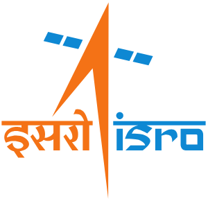

  
  
  # 🛰️ INSAT-3DS Temporal Enhancer
  **Next-Generation AI/ML Techniques for Seamless Temporal Interpolation of Geostationary Satellite Imagery**

  
  
  
  
  

A professional research platform built for interpolating and enhancing the temporal resolution of INSAT-3DS meteorological data.

---

## 🚀 Our Solution
We have built an end-to-end AI/ML optical flow pipeline designed to generate high-fidelity, synthetic intermediate satellite frames. This effectively upgrades the temporal resolution of existing satellite networks from 30 minutes to 15 minutes or even 7.5 minutes without requiring any new hardware in orbit.

By utilizing a **Physics-Informed Temporal U-Net**, our model learns the actual physical laws of the atmosphere, preventing the blurring and ghosting artifacts seen in legacy methods (like PySTEPS/Lucas-Kanade). 

## 🌪️ The Problem
Geostationary satellites like INSAT-3DS capture Earth observations at fixed intervals (30 minutes). However, rapidly intensifying weather phenomena such as **cyclones**, **wildfires**, and **flash floods** can evolve significantly within these intervals, leaving critical gaps in near real-time monitoring and forecasting.

## ✨ Key Features
- **MOSDAC-Style Interactive Viewer:** A pixel-perfect implementation of the official ISRO timeline viewer.
- **Optical Flow Interpolation (U-Net):** State-of-the-art frame synthesis using PyTorch.
- **Interactive Slider Comparison:** Drag-and-drop comparison mode for AI predictions vs Ground Truth.
- **Scientific Validation Metrics:** Real-time calculation of Structural Similarity (SSIM), PSNR, MSE, and FSIM.
- **Differential Heatmaps:** High-contrast Absolute Error Mapping and Thermal Gradient analysis (Sobel edge detection).
- **Native `.h5` Export:** Export raw interpolated tensors natively for downstream meteorological processing.

## 💻 Tech Stack
- **Frontend:** React, Vite, Tailwind CSS, Recharts, Lucide Icons.
- **Backend:** Flask, Python, OpenCV, NumPy, PyTorch (fallback capable for Windows).
- **Metrics/Data Handling:** h5py, scikit-image.

## 📄 License
This project is licensed under the **MIT License**. See the [LICENSE](LICENSE) file for details.

---
*Developed for the ISRO Remote Sensing Hackathon 2026*
